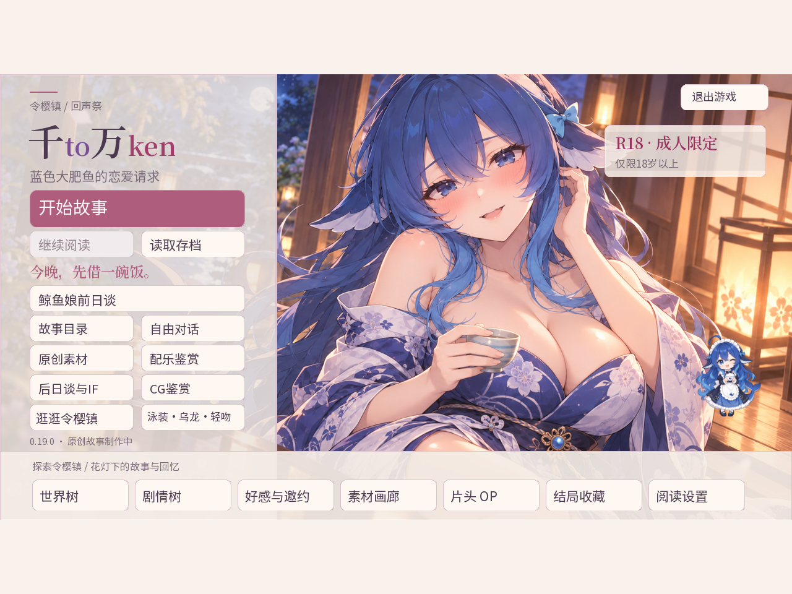

# 千to万ken / SenToManKen

海报为本地v0.19真实主页截图的4:3展示版。人物设计来源与图片使用说明见 [海报署名](docs/POSTER_CREDITS.md)。本项目与相关AI品牌或原设计作者没有官方合作关系。

原创成年 AI 娘恋爱喜剧，使用 Ren’Py 8.5.3。鲸鱼娘喜欢白米饭、会偷懒，也会在出事时把灯修好。角色的故事由预写剧情推进，可选 BYOK Agent 对话默认关闭。**仅限18岁以上。**

## 免费 Android 预览版已发布

前往 [v0.21 Android 预览版](https://github.com/870255475-del/sen-to-man-ken/releases/tag/v0.21.0-android-preview.1)，下载 **SenToManKen_v0.21_Android.apk**。安装后可运行，不需要另装Ren’Py SDK或Python。安装说明及SHA256校验文件在同一Release中。

APK为572,303,601字节，约545.8MiB；最低Android 5.0（API21），支持ARM32、ARM64及x86_64，需要OpenGL ES3。这是免费非商业分享的制作中预览版，尚未连接Android真机验证兼容性或FPS。

截至2026-10-10，已有共通7章及鲸鱼娘/GPT/Grok/Claude/Kimi各8章正文；另外6条完整角色线仍在制作。基线安卓版v0.19有80项事件CG与17项动作收藏、13个隐藏结局和7个坏/遗憾短IF。此处保留基线统计，不把媒体文件数量当成新的CG总数。这些短IF不是八章长篇，首通5–6小时也未经过玩家计时。

v0.21已新增独立泳池番外：约30秒动画、局部眨眼/轻微呼吸CG、两张独立出水艺术照和约3100字单次剧情、3处分支。完成鲸鱼娘恋人结局后，从标题→后日谈→「陪她歇一会儿」进入。不是完整Live2D。

## 网页版已上线

B站Toy：[肥鲸恋爱物语](https://www.bilibili.com/toy/qian-to-wan-ken/index.html)，官方作品列表已确认published / PUBLIC。网页端为图片音频压缩后的浏览器版本，关闭BYOK，与安卓包内容不同；不承诺已同步安卓v0.21泳池番外。

## 手机适配与验证

已发布APK的中央游戏与整个UI固定1280×720（16:9），对白框与按钮保持原位置。超宽设备只在左右使用当前场景/CG模糊延伸；标准16:9不增加区域。窄于16:9的平板居中显示，额外上下区域同样填充。

v0.20发布构建曾通过四项SDK touch模拟、124项断言，包括宽屏1200×540、标准960×540、平板1024×768；通过APK签名、全部ZIP成员CRC/SHA和205项媒体原字节核对。v0.21新增剧情另有同源3项SDK案例59断言；其APK全596成员CRC/SHA、212媒体和102编译脚本以及v1/v2签名已通过。前述SDK验证包括所选公开触摸存读档与片头/署名入口，不能当成真机安装、输入法、安全区或FPS实测，也不代表所有路线玩家通关。

## 仓库源码与 APK 的区别

仓库main目前仍是 **v0.20内容/桌面工作源码公开快照**，另含一张宣传海报，未跟踪游戏运行美术、音视频、字体、SDK、APK或Windows包。APK通过Release单独提供；克隆本仓库不能直接得到同一个可玩包。

已发布APK另实施了归档资源reader、Android平台存档路径、旧OP/原字节角色参考排除、角色资料重映射、原生启动片头及返回修复、可滚动素材署名页等窄改动。v0.21泳池正文、动态效果模块、视频及新图同样只在Release APK提供。**这些APK专用补丁尚未提交到main**，完整差异见 [Android构建说明](docs/ANDROID_BUILD.md)。本次没有修改Ren’Py引擎。

没有声明统一源码开源许可证，也没有给上游角色设计授予商业权。图像贡献、音乐、字体和引擎各按自己的许可范围使用，见 [素材许可与发行范围](docs/ASSET_RIGHTS.md)。

## 源码结构

- `game/*.rpy`：剧情、界面、路线、CG注册和手机比例适配。
- `game/python-packages/`：真实BYOK传输、内置成年角色人设和主线Agent。
- `game/story_data/`：场景、人设和结局目录。设计节点不计为已完成正文。
- `docs/ASSET_MANIFEST.json`：main工作快照所需素材的历史相对路径与SHA256，实体没有随源码分发；它不是本次APK的205项发行清单，也不授予旧素材再分发许可。新泳池视频为用户提供，原作者和公开转载权未独立核验；Release不授予统一商业或转载许可。
- `docs/ANDROID_BUILD.md`：已发布APK信息、与main的差异及构建边界。
- `tools/check_assets.py`：检查main快照本地路径是否齐全；不联网、不调用模型，不检查素材发行权限。

## API与隐私

默认不连接AI。玩家需自行填写服务地址、模型、Key并主动开启，模型费用由所选服务决定。免费游戏下载不代表外部API免费；正常预写剧情不需要开启接口。制作/验证没有发送真实模型请求。Key与对话采用内存会话，不写入存档；公开源码没有用户Key、存档或聊天记录。未把旧SDK底层直接FileLoad边界问题宣称为修复。

## 本地源码准备

1. 使用匹配的Ren’Py8.5.3 SDK创建或导入main快照。
2. 仅提供有权限使用的素材；main仍有旧素材路径，缺资源时不能直接启动，不会自动下载原作内容。运行`python tools/check_assets.py`只检查路径，不能用检查通过替代授权核对。
3. 若要复现已发布Android包，须等APK专用补丁公开或自行完成 [Android构建说明](docs/ANDROID_BUILD.md) 中的窄改动，并用官方RAPT重新构建、真机验收；当前main不是完整可复现APK源。
